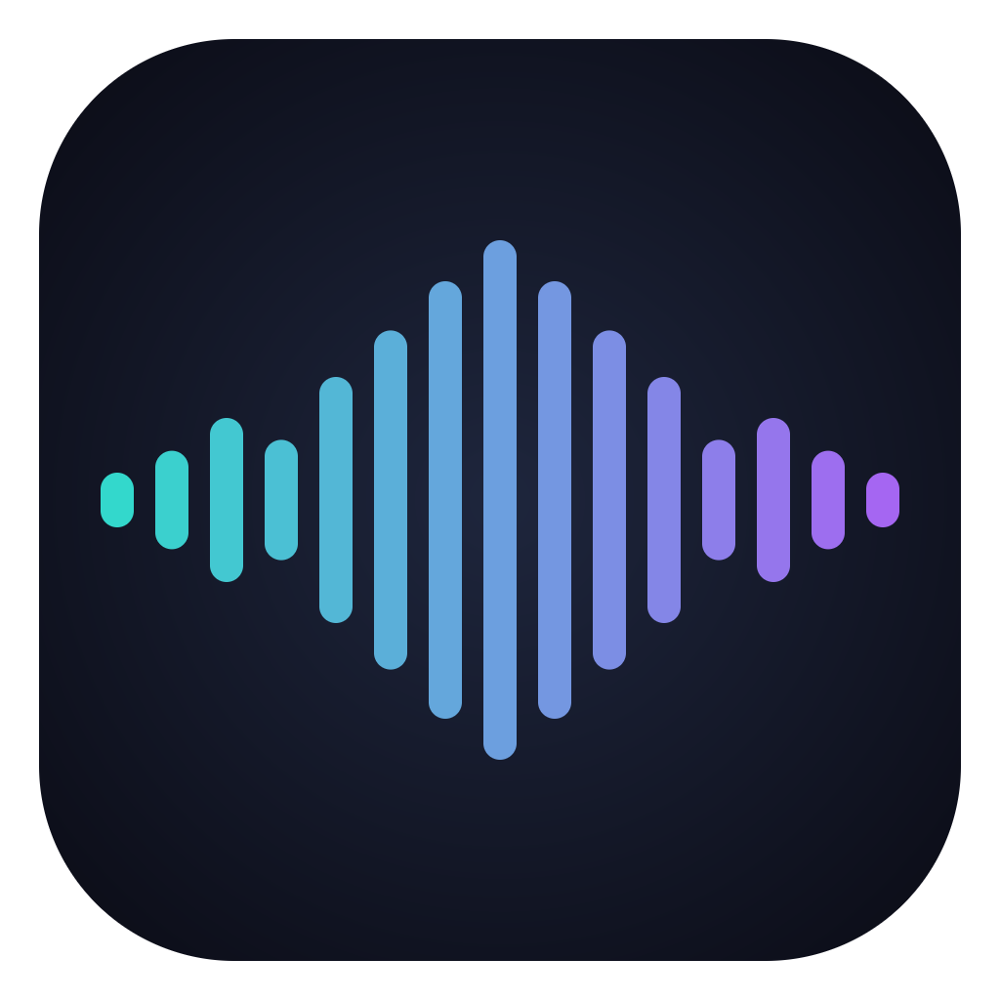
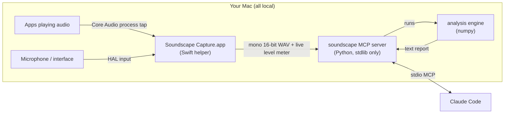

<p align="center"></p>

# Soundscape

**Let Codex or Claude listen to your Mac.** Soundscape is a Claude Code plugin that captures what your Mac
is playing (system audio output) or what a microphone hears, analyses it on device, and hands
Claude a compact **text report**: key, chords, tempo, melody, tuning, loudness, and speech. 

- **There is no screen recording** System audio comes from Core Audio *process taps*, an
  audio-only macOS API. 
- **Few tokens.** A three-minute song becomes a report of roughly 300–600 tokens, not megabytes of
  audio or video.
- **Fully local.** A local stdio MCP server plus a small Swift capture helper. Nothing leaves your Mac.

```
/soundscape:output what key is this song in?
```
> 🎧 Listening to your Mac — play it now. I'll analyse when it stops.
>
> It's in **A minor**. The loop is Am – F – C – G (i – VI – III – VII) at about 100 BPM. It could also be
> heard as C major (same notes), but it opens and resolves on Am and the bass centres on A.

---


## Continuous listening in Codex (0.3.0)

Install the plugin locally with the supported Codex plugin flow:

```bash
codex plugin marketplace add /absolute/path/to/soundscape
codex plugin add soundscape@soundscape
```

Start a new Codex chat after installation (restart the app if the new tools are not visible).
Use `$soundscape input on` or say **Soundscape input on**. Play your clip and then ask:

> Identify the chord progression, transcribe the notes, make a multiple-choice practice image,
> and play the excerpt back.

Say **Soundscape input off** to stop. In Claude, `/soundscape:input` now also stays on between
questions. `start(continuous=true)` returns immediately; `peek` and `stream` analyse recent
snapshots without ending capture. Silence does not stop listening. The MCP connection must stay
open: closing its chat/client or restarting the server stops capture. `stream` provides reports
when called, not automatic chat messages while the assistant is idle.

**AirPods:** select AirPods as your Mac's output. The system-audio tap captures what plays through
them. Prefer **MacBook Pro Microphone** (or your actual built-in input from `setup`) for mic capture;
selecting an AirPods microphone may switch the Bluetooth audio mode. Desktop-only capture uses
`source="output"` and needs no microphone.

**Tools added:** `stream` (incremental reports), `replay` (saved WAV and optional local playback),
and `practice_card` (multiple-choice PNG). Replay defaults to the exact last analysed excerpt,
up to 120 seconds, so it still works after answering/rendering. Use `from_analysis=false` to replay
the latest audio instead. Playback can enter the system tap; do not treat it as fresh evidence.
Practice images are original AP-style study material, not official AP questions. Soundscape does
not capture desktop screenshots; it can pair audio reports with a screenshot you supply to Codex.

Speech transcription uses optional local mlx-whisper (`setup(install_transcription=true)`);
its weights download on first use. Musical note/chord transcription remains an estimate, not a
complete engraved polyphonic score. The agent supplies image question/choices from the report.

Continuous capture rotates WAV segments every five minutes and retains the active segment plus
the two previous segments (10–15 minutes). Queries read up to 10 minutes; the default is 30 seconds.
Stopping a continuous session analyses the last minute, or use `stop(analyze=false)` for immediate
OFF. Saved excerpts/images expire through the normal seven-day cleanup; `purge_recordings` removes
all saved session artifacts. All capture and analysis run locally.

## Slash commands

| Command | Listens to | Good for |
|---|---|---|
| `/soundscape:output [question]` | everything the Mac plays, from any app and on any output device (speakers, AirPods, interface) | "what key / chords / BPM is this?", "how loud is my master?", "what are they saying in this video?" |
| `/soundscape:input [question]` | the microphone or any input device (audio interface, loopback), **plus** the Mac's own output at the same time | "is my guitar in tune?", "what note am I singing?", "what key is this practice clip in?" |

**Input mode works with the volume muted.** A microphone can't hear muted speakers, so an input session
records the mic *and* the Mac's own audio side by side. It then analyses whichever actually carried the
sound, and says which one in a `NOTE:` line. Play an ear-training clip in the browser with the volume at
0, run `/soundscape:input what key is this?`, and it still answers. Sing or play an instrument with
nothing playing on the Mac, and it analyses the mic.

The first run sets everything up automatically. It builds the capture helper, installs the analysis
engine, and macOS asks once for permission. Then Claude starts listening and tells you to play.
It keeps listening between questions until you turn it off; each answer uses a recent snapshot. You can also just ask in plain words ("listen to what I'm
playing and tell me the key"): both commands double as model-invoked skills.

## Example report (what Claude reads)

This is real output from a live capture of system audio:

```text
SOUNDSCAPE · system audio output · 0:34 captured · sound 0:31 (analysed 0:00–0:31)
Content: music (confidence high)
At a glance: A minor (high) · 100 BPM · loop Am–F–C–G · ≈−28 LUFS
KEY: A minor  (confidence high; profile fit 0.79)
  next best: C major 0.88, relative; F major 0.57; G major 0.56
  note: C major uses the same notes and fits the pitch profile slightly better, but the music
        centres on A (opening/closing chord, bass, time spent) — tonic evidence 0.95 vs 0.33
  mode: Aeolian (natural minor); 92% of pitched energy is in-scale
  tuning: A4 ≈ 439.7 Hz (-1 cents vs 440)
  pitch-class share (strongest first):
    C  ██████████ 19.6%
    A  █████████· 17.9%
    G  █████████· 17.6%
    E  ███████··· 13.5%
    ...
  bass centres on: A 26%, F 24%, G 22%
CHORDS (beat grid; numerals in A minor)
  main progression (×3.2): Am – F – C – G   (i – VI – III – VII)
  most used: Am (i) 32%, F (VI) 23%, C (III) 23%, G (VII) 22%
TEMPO: 99 BPM (confidence high; could also be felt as 200 or 50) · steady
```

### Ear training / music-theory questions

Short clips (a chord, an interval, a scale, a cadence) get an event-by-event theory read. Ask
`/soundscape:input what kind of chord is this?` and play the chord, on the Mac (muted is fine) or
into the mic:

```text
THEORY (each sound event; notes low→high, as heard)
  #1 0:00.2–0:02.7  B2 D3 F#3 G#3 → G#ø7: G# half-diminished seventh (ø7, dm7), 6/5 (1st inversion)
       spelled G#–B–D–F# · bass B · soprano G#3 · above bass: m3 P5 M6
       could also be spelled: Bm6 (minor sixth (added 6th))
```

```text
  #4 0:03.1–0:04.0  G2 G3 B3 D4 F4 → G7: G dominant seventh (Mm7, major-minor 7th), 7 (root position) · V7 in C major
  #5 0:04.0–0:05.2  C2 E3 G3 C5 → C: C major triad, 5/3 (root position) · I in C major
  cadence (in C major): perfect authentic cadence (PAC): V(7)→I, both in root position, tonic in the soprano
```

It covers:
- **Chords:** every triad and seventh-chord quality (MM7, Mm7, mm7, ø7, °7, mM7, +M7), plus sus, 6 and 9 chords.
- **Inversions:** with figured bass and spelled tones.
- **Intervals:** harmonic and melodic, simple and compound.
- **Scales:** major, the minors, the modes, pentatonic, blues, whole-tone, octatonic.
- **Cadences:** PAC, IAC, HC, plagal, deceptive, Phrygian HC.

Modal music gets its real tonal centre. A G#m7 → Amaj7 vamp is reported as **G# Phrygian (i7 – ♭IImaj7)**,
not just "C# minor" because it shares those notes.

Every report can focus on one of: `overview` · `key` · `chords` · `theory` · `tempo` · `melody` ·
`tuning` · `mix` · `speech` · `all`. Each comes at `brief`, `standard` or `full` detail.

## How it works



| Piece | What it does |
|---|---|
| `helper/SoundscapeCapture.swift` | Captures **system output** with a global process tap (macOS 14.2+), or any **input device** via its HAL IOProc. Downmixes to mono and writes a WAV that stays readable while recording. Streams JSON level events. It is built into an ad-hoc-signed `.app` in `~/.soundscape`, and spawns itself "responsibility-disclaimed", so macOS permissions belong to *Soundscape Capture* whichever app launched it (Claude, Terminal, VS Code…). |
| `src/soundscape_mcp/` | A zero-dependency MCP server (JSON-RPC over stdio) that starts instantly. It manages listening sessions, detects when audio starts and stops, streams progress, and runs setup on demand. |
| `src/soundscape_engine/` | The numpy analysis engine. It estimates tuning from spectral peaks, builds tuning-corrected chroma, and finds the key from an ensemble of three key profiles (Krumhansl-Kessler, Temperley, Sha'ath). Tonic evidence settles relative major/minor ties. It adds a mode hint and key-over-time, and reads chords from templates with HMM (Viterbi) smoothing on a beat grid, labelled with Roman numerals and loop detection. Tempo comes from onset autocorrelation plus dynamic-programming beat tracking. Notes come from YIN pitch tracking (melody and tuner). Loudness is BS.1770-style LUFS. It also reports tonal balance, speech cues, and the music / speech / noise classification. |

### MCP tools

`setup` · `start` · `wait` · `peek` · `stream` · `replay` · `practice_card` · `stop` · `listen` · `analyze_file` · `sessions`.

`start`/`listen` with `source: "input"` also capture system audio unless `include_system_audio: false`.

A continuous run is `setup → start(source, continuous=true) → peek/stream → … → stop`.
`wait` can wait for the next clip without ending capture. `listen` performs a timed one-shot capture. `analyze_file` reports on any audio or video file on disk.

## Install

**Requirements:** macOS 14.2+ for system-output capture (the mic works on 13+), the Xcode Command Line
Tools (`xcode-select --install`), and Python 3.9+. [`uv`](https://docs.astral.sh/uv/) is used if present but not required.

In Claude Code:

```
/plugin marketplace add nealrau/soundscape
/plugin install soundscape@soundscape
```

Or from a shell:

```bash
claude plugin marketplace add nealrau/soundscape && claude plugin install soundscape@soundscape
```

Restart Claude Code, then run `/soundscape:output` or `/soundscape:input`. The first call builds the
helper (about 20 s) and installs numpy into `~/.soundscape/venv`.

### Claude Desktop (chat) or any other MCP client

The server is a plain stdio MCP server. Clone the repo and point your client at the launcher, e.g. in
`~/Library/Application Support/Claude/claude_desktop_config.json`:

```json
{ "mcpServers": { "soundscape": { "command": "/path/to/soundscape/bin/soundscape-mcp" } } }
```

### Shell

Every tool can also be called directly:

```bash
bin/soundscape-mcp setup
bin/soundscape-mcp listen '{"source": "output", "seconds": 60, "focus": "key"}'
bin/soundscape-mcp analyze_file '{"path": "~/Music/song.m4a", "focus": "chords", "detail": "full"}'
```

## Permissions

macOS asks once per capability, and the prompt names **Soundscape Capture**:

| Capability | Prompt | Where to change it later |
|---|---|---|
| System audio (`/soundscape:output`) | "…would like to record audio from your system" | System Settings › Privacy & Security › Screen & System Audio Recording › *System Audio Recording Only* |
| Microphone (`/soundscape:input`, which also uses system audio) | "…would like to access the microphone" | System Settings › Privacy & Security › Microphone |

System-audio capture taps each app's output **before** the volume control. Soundscape can listen
while your Mac is muted, so you can analyse something silently.

## Privacy & data

- Audio is captured and analysed on your Mac. Claude only receives the text report.
- Recordings and reports go to `~/.soundscape/sessions/` so you can re-analyse them. They are
  **deleted automatically after 7 days** (set `SOUNDSCAPE_RETENTION_DAYS`). Ask Claude to purge them
  (`sessions` with `purge_recordings: true`), or pass `keep_audio: false` to `stop`.
- Capture runs only while a session is active. Timed sessions auto-stop after `max_seconds` (default
  10 min); continuous sessions stay on until stopped. All helpers exit if the server goes away.

## Optional: speech transcription

The `speech` focus reports speech cues (syllable rate, pauses, voice pitch). For a full transcript, ask
Claude to run `setup` with `install_transcription: true`. That installs [mlx-whisper](https://github.com/ml-explore/mlx-examples/tree/main/whisper)
(Apple Silicon, on-device). The model downloads on first use; pick another one with `SOUNDSCAPE_WHISPER_MODEL`.

## Accuracy & limits

The test suite (`tests/`) checks the engine on synthesized music with known answers:

- **Keys:** C, Bb detuned +31 cents, F#, A harmonic minor, E minor vs its relative G major.
- **Modal centres:** G# Phrygian, D Dorian, G Mixolydian.
- **Tempo:** 84 / 100 / 128 BPM.
- **Chords:** all ten triad and seventh qualities, inversions with figured bass, and spelling (G#°7 = G#–B–D–F).
- **Intervals, scales and cadences:** harmonic and melodic intervals, Dorian and harmonic-minor scales, PAC and HC.
- **Other:** tuner accuracy (±4 cents), speech vs music, and silence.

Real recordings are harder. Expect the main error to be **relative-key confusion** (C major vs A minor),
which the report flags. Dense or heavily distorted mixes and drum-only tracks give lower-confidence key
and chord reads. Modal music and modulations are reported as hints. The report always states confidence,
so Claude can hedge.

## Troubleshooting

| Symptom | Fix |
|---|---|
| Report says *SILENCE* / "digital silence" on output | Check something is playing, then the System Audio Recording permission above. If you rebuilt the helper, toggle Soundscape Capture off and on. |
| Mic only hears noise | Wrong device or muted mic. Run `setup` to list inputs, then pass `device` (name or UID). |
| `capture helper build failed` | `xcode-select --install`, then `setup` with `rebuild: true`. |
| Reset permissions | `tccutil reset AudioCapture com.nealrau.soundscape.capture` and `tccutil reset Microphone com.nealrau.soundscape.capture` |
| Logs | `~/.soundscape/logs/` |

## Development

```bash
~/.soundscape/venv/bin/python -m unittest discover -s tests -v   # engine tests
helper/build.sh /tmp/SoundscapeCapture.app                         # build the helper elsewhere
claude plugin validate .                                           # plugin manifest checks
```

```
.claude-plugin/   plugin.json, marketplace.json, icon
.mcp.json         registers the local MCP server
skills/output/    /soundscape:output
skills/input/     /soundscape:input
bin/              soundscape-mcp launcher (server + CLI)
helper/           Swift capture helper + Info.plist + build script
src/              soundscape_mcp (server), soundscape_engine (analysis; theory.py = ear training)
tests/            synthetic-audio accuracy tests
```

MIT licensed.
